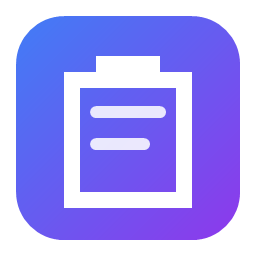
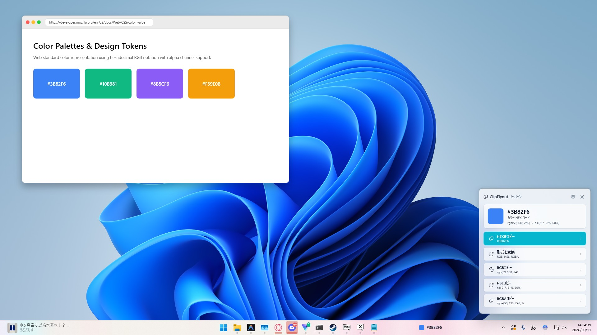

# ClipFlyout

A small resident Windows utility that handles the "little conversions" of whatever you copy, right where you are.

[-0078D4.svg)](https://github.com/featlis/ClipFlyout)

[Download](https://github.com/featlis/ClipFlyout/releases/latest) ・ [Manual](docs/manual.en.md) ・ [日本語](README.md)

## What it does

Formatting a bit of JSON shouldn't mean opening a converter site. Neither should turning a hex color into RGB, or stripping tracking parameters from a URL before sharing it.

ClipFlyout watches what you copy, figures out its format, and shows a small flyout at the edge of the screen with the actions that make sense for it. Click one and the result goes back to the clipboard, ready to paste. The flyout never takes keyboard focus, so whatever you were typing is not interrupted. The latest item is also shown in a small taskbar widget.

## Usage

1. Download the installer from [Releases](https://github.com/featlis/ClipFlyout/releases/latest) and run it (a portable ZIP is also available)
2. Copy as usual with `Ctrl + C`
3. Click an action in the flyout

After the flyout disappears, `Alt + Shift + C` brings the last one back.

## What it detects (highlights)

- **Colors**: preview for `#RRGGBB`, convert to RGB / HSL
- **Timestamps**: Unix time (seconds / milliseconds) to a date string or ISO 8601
- **JSON**: pretty-print or minify
- **URLs**: strip tracking parameters (UTM etc.), generate a QR code, copy just the domain
- **Text**: CSV to a Markdown table, Base64 decoding, JWT payload inspection, camelCase ⇄ snake_case, character counts
- **Images**: check size and aspect ratio, save as PNG

13 formats are supported in total. The full list and all settings are in the [manual](docs/manual.en.md).

## Privacy

Everything runs locally on your PC. Clipboard contents are never sent anywhere.

Copies from password managers are ignored. Detection is based on the process name of the window the copy came from: 1Password, Bitwarden, KeePass, KeePassXC, LastPass, Dashlane, Enpass, and NordPass are covered, and the check can be turned off in settings. Copies that an app marks as "keep out of history" are ignored as well.

## Requirements

- Windows 11 / 10 (x64)
- The installer works with standard user permissions. Settings are stored in your local AppData folder.

## For developers

Built with .NET 9 / WPF. See the [developer notes](docs/development.md) for build steps and code layout, and [CONTRIBUTING.md](CONTRIBUTING.md) for how to file issues and PRs.

## License

[GPL-3.0-or-later](LICENSE) — by [featlis](https://github.com/featlis) and contributors
