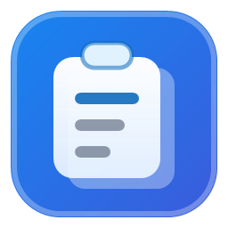
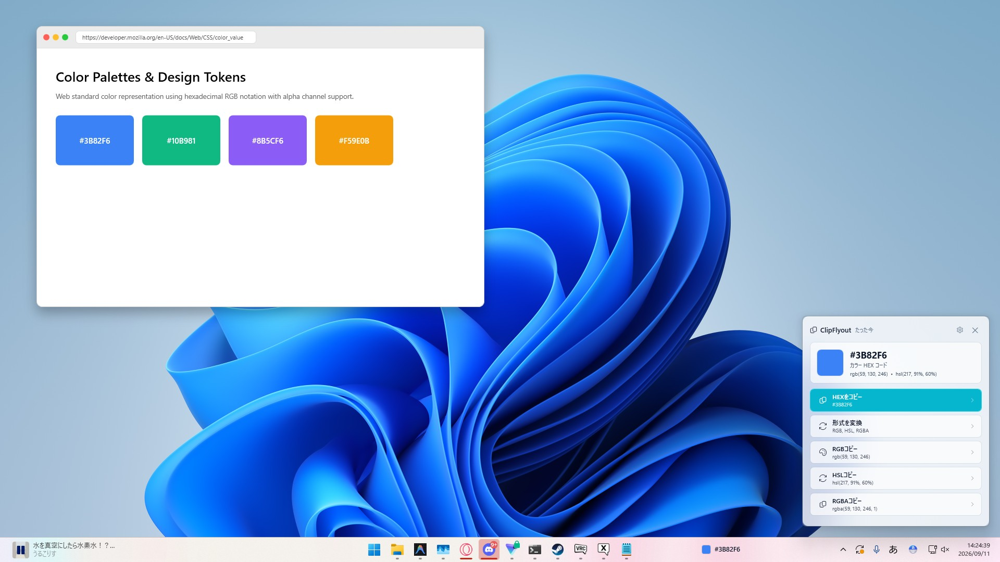

# ClipFlyout

A small resident Windows utility that handles the "little conversions" of whatever you copy, right where you are.

[-0078D4.svg)](https://github.com/featlis/ClipFlyout)

[Download](https://github.com/featlis/ClipFlyout/releases/latest) ・ [Manual](docs/manual.en.md) ・ [日本語](README.md)

## What it does

Formatting a bit of JSON shouldn't mean opening a converter site. Neither should turning a hex color into RGB, stripping tracking parameters from a URL before sharing it, or transcribing the text in a screenshot.

ClipFlyout watches what you copy, figures out its format, and shows a small flyout at the edge of the screen with the actions that make sense for it. Click one and the result goes back to the clipboard, ready to paste. The flyout never takes keyboard focus, so whatever you were typing is not interrupted. The latest item is also shown in a small taskbar widget, and your copy history and saved snippets are one right-click away in the tray.

## Usage

1. Download the installer from [Releases](https://github.com/featlis/ClipFlyout/releases/latest) and run it (a portable ZIP is also available)
2. Copy as usual with `Ctrl + C`
3. Click an action in the flyout (or pick one with `↑` / `↓` + `Enter`, or the number keys `1`–`9`)

After the flyout disappears, `Alt + Shift + C` brings the last one back. The shortcut can be changed in settings.

## What it detects (highlights)

- **Colors**: preview for `#RRGGBB` and friends, convert between HEX / RGB / HSL / RGBA
- **Dates**: Unix timestamps ⇄ date strings and ISO 8601
- **JSON**: pretty-print or minify
- **URLs**: strip tracking parameters, generate a QR code, copy just the domain
- **Text**: CSV to a Markdown table or JSON, Base64, JWT payload inspection, case conversion, math and hex/binary conversion, UUID reformatting and generation (v4 / v7), SHA-256
- **Files and paths**: copy paths of files copied in Explorer, Windows ⇄ WSL path conversion, open in a terminal
- **Images**: check size and aspect ratio, save as PNG / JPG / BMP, extract text with the built-in Windows OCR

18 formats are supported in total. The full list and all settings are in the [manual](docs/manual.en.md).

## Privacy

Everything runs locally on your PC. Clipboard contents are never sent anywhere, and history persistence is off by default — items are kept only if you turn it on.

Copies from password managers are ignored. Detection is based on the process name of the window the copy came from: 1Password, Bitwarden, KeePass, KeePassXC, LastPass, Dashlane, Enpass, NordPass, RoboForm, and Proton Pass are covered. The check can be turned off in settings, and you can add your own apps to the exclusion list. Copies that an app marks as "keep out of history" are ignored as well.

Updates are downloaded only from GitHub Releases and are verified against the release SHA-256 checksums before they run.

## Requirements

- Windows 11 / 10 (x64)
- The installer works with standard user permissions. Settings are stored in your local AppData folder.

## For developers

Built with .NET 10 / WPF. See the [developer notes](docs/development.md) for build steps and code layout, and [CONTRIBUTING.md](CONTRIBUTING.md) for how to file issues and PRs.

## License

[GPL-3.0-or-later](LICENSE) — by [featlis](https://github.com/featlis) and contributors
