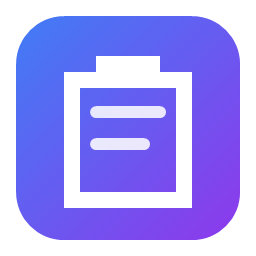
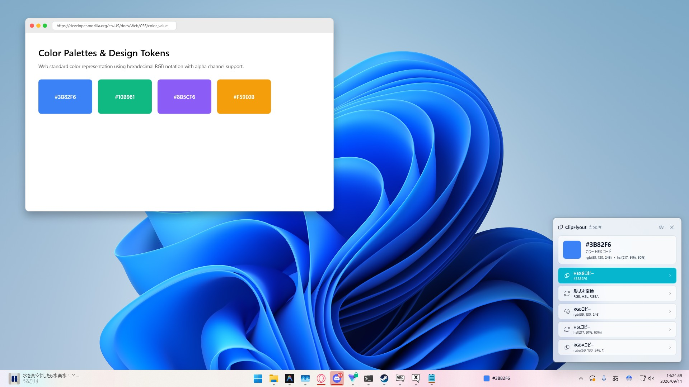

# ClipFlyout

コピーしたテキストの「ちょっとした変換」を、その場で済ませるための Windows 常駐アプリです。
*Copy something — JSON, a color code, a timestamp — and ClipFlyout offers the conversion right where you are.*

[-0078D4.svg)](https://github.com/featlis/ClipFlyout)

[ダウンロード](https://github.com/featlis/ClipFlyout/releases/latest) ・ [マニュアル](docs/manual.md) ・ [English](README.en.md)

## 何をするアプリか

JSON を整形したいだけなのに変換サイトを開く、カラーコードを RGB に直す、共有前に URL の追跡パラメータを消す。そういう小さな変換のために作業が中断されるのが面倒で作りました。

ClipFlyout はコピーした内容の形式を判別し、画面端の小さな窓（フライアウト）に「できそうなこと」を並べます。ボタンを押せば変換結果がクリップボードに戻るので、そのまま貼るだけ。窓はフォーカスを奪わないので、入力中の作業は止まりません。最新の内容はタスクバー上のウィジェットにも表示されます。

## 使い方

1. [Releases](https://github.com/featlis/ClipFlyout/releases/latest) からインストーラーをダウンロードして実行する（ZIP 版もあります）
2. 普段どおり `Ctrl + C` でコピーする
3. 画面端に出たフライアウトのボタンを押す

フライアウトが消えたあとでも、`Alt + Shift + C` で直前のものを再表示できます。

## 拾ってくれるもの（抜粋）

- **色**: `#RRGGBB` のプレビュー、RGB / HSL への変換
- **日時**: Unix タイムスタンプ（秒 / ミリ秒）から日時文字列・ISO 8601 へ
- **JSON**: インデント整形、1 行化
- **URL**: UTM などの追跡パラメータ除去、QR コード生成、ドメインだけコピー
- **テキスト**: CSV → Markdown 表、Base64 デコード、JWT のペイロード表示、camelCase ⇄ snake_case、文字数カウント
- **画像**: サイズとアスペクト比の確認、PNG で保存

対応形式は全部で 13 種類あります。一覧と設定項目の詳細は [マニュアル](docs/manual.md) に置いてあります。

## プライバシーについて

変換はすべてこの PC の中で行い、クリップボードの内容を外部に送信することはありません。

パスワードマネージャーからのコピーは対象外です。判定はコピー元ウィンドウのプロセス名で行っていて、1Password / Bitwarden / KeePass / KeePassXC / LastPass / Dashlane / Enpass / NordPass に対応します（設定でオフにもできます）。アプリ側で「履歴に残さない」と指定されたコピーも同様に対象外です。

## 動作環境

- Windows 11 / 10 (x64)
- インストーラーは標準ユーザー権限でインストールできます。設定はローカルの AppData に保存されます

## 開発する人へ

.NET 9 / WPF 製です。ビルド手順とコードの構成は [開発者向けメモ](docs/development.md)、Issue や PR の流れは [CONTRIBUTING.md](CONTRIBUTING.md) を見てください。

## ライセンス

[GPL-3.0-or-later](LICENSE) — 開発: [featlis](https://github.com/featlis) and contributors
